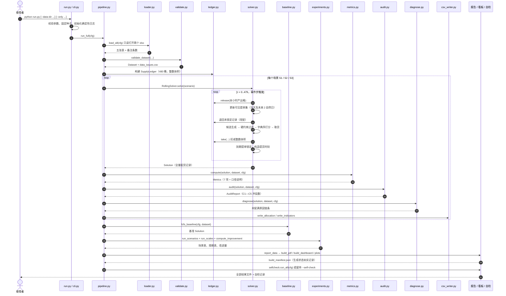
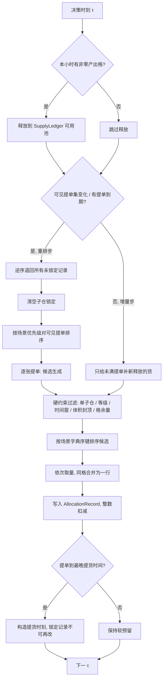
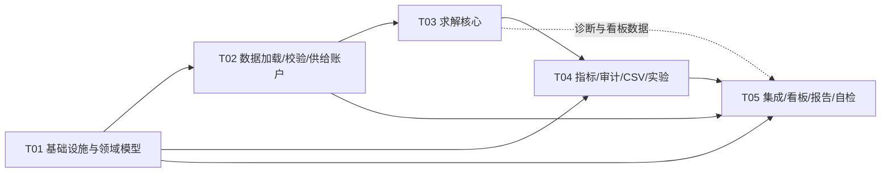

# 03 系统设计

这份文件把前面两份材料（文档核对、需求基线）里确定的要求，落成一套能直接开工的项目结构、模块划分和任务顺序。写的时候只依据 `01_文档核对.md` 中「文档已明确」的部分；凡是材料没写明的口径，一律放到第九节的假设决策表里，按最小、保守的方式定下来，并且在方案文档里明确标成自己假设的。

工程实现阶段照第六节的五个批次顺序推进即可，每个批次列了涉及文件、前置依赖和完成判据。第十节留了几处需要主理人拍板的地方，其中 A5 那条影响最大，建议先确认再动手写求解器。

项目根目录是 `E:\self\shein\allocation\`。原始资料包在同级目录 `E:\self\shein\F3_一舱装满_资料包\`，官网材料在 `E:\self\shein\比赛详情\`，两者全程只读引用，不复制、不改动。

---

## 一、实现方案与框架选型

### 1.1 这套程序实际要处理的事

输入是五张表：货源宽表、每天体积重量密度、宽表第一张「数据使用备注」、提单明细、目的港单kg成本。其中宽表 301 行 × 480 个小时列，撑开后是 144480 个「渠道 × 子仓 × 产出小时」的供给格，去掉零值还有约 65512 个非零格；提单 2652 张。要产出的不是一句「配了多少」，而是一行一条的明细记录，每一条都能被评委按五条硬约束核对回去。

难点不在数据量本身，在四个地方：

1. **体积口径**。宽表的「合计体积」列是 480 个小时列之和四舍五入到两位的结果，单行最大能差 0.0050 m³，全表差 0.0292 m³。拿它做守恒基准一定对不上。必须只用 480 个小时列的原始四位小数值。
2. **时间耦合**。货按小时陆续产出，提单有最早提货时间、最晚提货时间（用需求到站时间），还有「站在当天只能看到当天及未来两个自然日提单」的可见窗口；已配但未提走的货还能改配。这些口径材料只给了边界描述，具体切法要自己定。
3. **多目标不是单目标加权**。优先级是固定的字典序（配满率 > 敏感品完全匹配率 > 时效积压率 > 主注入点选择率 > 成本），还要给出不同优先级顺序下的对比。如果一上来就拍一个加权和，优先级顺序就换不动了。
4. **结果必须可复算、可复跑**。指标要能从 `allocation.csv` 加原始表复算；两次运行产出的 CSV 要能逐字节比对。

另外有一堆看着像约束、其实不是的东西：注入点匹配、24 小时匹配、计划起飞时间、半配惩罚、限重/耗材/计费重/集装板尺寸/清关资质/可混配组合。前四个是软目标或背景描述，后六个是明确排除的规则。实现里既不能把它们当硬约束，也不能让它们出现在未配满原因诊断里。

### 1.2 选型约束

运行环境实测是 Python 3.13.14，已装 openpyxl 3.1.5、numpy 2.5.4、matplotlib 3.11.2，没有 pandas、scipy、pytest、ortools，pip 能联网但依赖要尽量少。交付物里有一堆文档和一个看板，但看板不该把 Vite/React 变成必需依赖——它是选做加分项，不该拖累核心链路的安装。

所以核心链路定为 **Python 标准库 + openpyxl 只读解析**。标准库覆盖 csv、json、datetime、argparse、hashlib、heapq、collections、math、logging、time、pathlib；openpyxl 只用来 `load_workbook(read_only=True, data_only=True)` 读 xlsx，不写回、不建索引文件、不落中间缓存。

### 1.3 为什么不上求解器和重型框架

- **没有可用求解器，也不该装**。材料里「如列生成、分支定价」是举例，不是指定技术路线；官网和赛题都明确允许用启发式给近似前沿，只要写明方法和局限。为一个明确允许近似的题目去装 ortools/scipy，换来的全局最优性在评审口径里并不加分（补充说明第六节写得很清楚：各项指标自己量化，评审按写明的口径核对，不跨队比较绝对数值），反而让「一键跑通」和「从原始 xlsx 复跑」多两个安装步骤。
- **可审计性比最优性更重要**。五条硬约束要逐条核对、每条配货记录要能追溯，启发式的「先过滤硬约束，再按打分取货」天然把决策理由留在了代码里；换成黑盒求解器，未配满原因链条反而难写。
- **规模撑得住**。非零格约 65512，提单 2652，用整数化体积 + 按 (子仓, 敏感品等级) 分桶的供给账户 + 事件触发的滚动重排，纯 Python 的量级是「非零格 × 一次排序 + 记录数 × 常数」，预计几十秒到两分钟。五分钟是官网举例的措辞，不是硬性 SLA，但按这个设计落在同一个量级里没有压力。
- **后端、前端框架都不需要**。结果文件是 CSV，看板是单页静态 HTML + 内联 JS + SVG，离线双击能开，不需要构建步骤，也不需要 Node。

numpy 在这个设计里是可选的，只用于规模曲线里做点统计拟合；缺失时自动退回纯 Python 计算。matplotlib 也只用于画曲线 PNG，缺失时输出 SVG 或直接给数据表。

### 1.4 算法路线

整体是「滚动时域 + 候选生成 + 字典序打分（近似 Pareto） + 改配 + 后处理审计」，五段各自独立，方便分别验证。

**滚动时域**　时间轴是 480 个小时（2026-10-01 00:00 到 2026-10-20 24:00）。决策时刻 τ 按小时推进。每一步做四件事：把刚结束那一小时产出的货放进可用池；按 τ 所在自然日算出可见窗口，更新可见提单集；把已到最晚提货时间的提单定稿锁定；给尚未配满的可见提单补货。为了避免 480 步每步都全量重算，只有「可见提单集变化 / 新的非零货释放 / 有提单到期」这些事件步才触发重排，其余步做增量分配。

**候选生成**　给一张提单找货时，先按硬约束把范围收窄，再谈打分：
- 单张提单只提一个子仓，所以第一次分配时给它锁定一个子仓，之后所有行都用这个子仓；
- 货的敏感品等级 ≤ 提单等级（等级按「渠道 × 子仓」这一行取，多层逗号串取最高，锂电 > 干电 > 敏感普货 > 无）；
- 该批货的可配时刻 ≤ 提单最晚提货时间（异常 233 张用「最早提货时间 + 24h」当上界）；
- 剩余体积 > 0，且配出去之后不超过提单计划体积；
- 同一张提单、同一 (渠道, 子仓, 产出小时) 只产生一行，取货时先合并再写。

被排除的六类规则在这层完全不出现，也不进诊断的原因枚举。

**字典序打分与近似 Pareto**　对候选 (供给格, 可取量) 构造一个五层键，层次顺序由「场景」配置决定：配满贡献、敏感品是否完全匹配、时效积压（库内等待超过 24h 的时长 × 方数）、是否主注入点、成本。默认场景就是材料给的顺序；把成本或时效提到第一层，就是另外两个场景。层内比较用统一的「越大越好」方向，层间严格字典序，不做加权求和——这样换顺序时不必重新调权重。

三个场景各产出一个解，把它们的五维目标向量做一次非支配筛选，在实验报告里列出哪些解非支配、谁被谁支配，作为近似 Pareto 前沿。这是启发式采样出来的几个点，不是真实前沿，报告里要直说。

**改配**　提单的提货时刻到达之前，配货记录只是软预留。触发重排时，把所有未锁定的记录按逆序退回供给账户，清空子仓锁定，再按当前场景的优先级对可见提单重新分配。退回用整数体积精确恢复，不会破坏守恒。到期的记录锁定后不再改动。这一步就是「已配的货没被提走前可改配」的落点。

**后处理审计**　求解器自己已经按硬约束构造，但审计是另一套独立代码：重新只读加载原始 xlsx，拿着 `allocation.csv` 逐条重算五条约束、体积守恒容差、格式、指标可复算、两次运行的哈希。它不信任求解器的内部状态，只信输入文件和输出文件。

**贪心基准**　单独一个模块，共用供给账户和硬约束检查，只换选择策略：提单按 (最早提货时间, 提单号) 升序逐个处理，锁定第一个有货的子仓，供给按 (产出小时, 渠道ID, 子仓ID) 先到先给，不回头、不改配、不优化任何软目标。这样对照的是「选择策略」本身，不是两套实现差异。

### 1.5 规模与耗时

供给格按「可配时刻」分 480 个桶，桶内按 (子仓ID, 敏感品等级, 渠道注入点是否匹配, 产出小时, 渠道ID) 排序，取货时从对应桶顶取，不做每步全表扫描。规模实验用 `random.Random(种子)` 从「渠道 × 子仓行、提单、小时列」确定性抽 25% / 50% / 100% 三档，不引入外部数据。

实际耗时写进自检记录，不作为复现一致性判据（机器差异会影响 wall time）。自检比的是 CSV 内容哈希。

### 1.6 这套路线的局限，要写进报告

- 启发式不保证全局最优，也不保证覆盖真实 Pareto 前沿，只给三个采样解的非支配关系。
- 改配只在事件步触发，不是连续重优化；两个事件之间新到的货按增量规则补，可能错过更优组合。
- 子仓一旦在某一轮被锁定，该轮内不再换仓；下一轮重排才有机会重选。
- 未来货量预测、并查集并行化、在线 Demo、演示视频都不做，属于可选或举例项，列入未完成清单。
- 所有指标公式是自定口径，只在本方案内部可比，不与其他队伍的绝对数值比较。

---

## 二、完整文件清单

以下路径都以 `E:\self\shein\allocation\` 为根。`docs/01_文档核对.md`、`docs/02_需求基线.md` 是前序产出，只读引用，不修改。

### 根目录与配置

| 路径 | 职责 |
|---|---|
| `README.md` | 项目说明、目录导览、快速开始、依赖、合规声明、赛后删除要求 |
| `requirements.txt` | 精确版本依赖，区分必需 / 可选 / 明确不引入 |
| `run.py` | 一键入口，转发到 `src/cli.py`；`python run.py` 跑全流程，`python run.py --self-check` 跑自检 |
| `.gitignore` | 排除 `results/`、原始 xlsx、`__pycache__/`、`_prev/`、字体缓存，保证公开产出不含资料包数据 |
| `config/settings.json` | 原始 xlsx 相对路径、评估范围、随机种子、场景组、规模档、滚动频率、精度、输出路径、功能开关 |
| `config/constraints.json` | 五条硬约束的编号与检查项元数据；被排除六类规则的黑名单；诊断原因白名单 |

### 源码 `src/`

| 路径 | 职责 |
|---|---|
| `src/__init__.py` | 包声明，导出版本号 |
| `src/cli.py` | argparse 子命令、参数校验、退出码、日志初始化、调用编排层 |
| `src/config.py` | 加载 `settings.json`、命令行覆盖、集中常量（等级映射、SHJ、CSV 列名、精度单位、评估范围） |
| `src/errors.py` | 自定义异常层次与退出码映射 |
| `src/logging_util.py` | 确定性日志；可关时间戳，保证日志也不影响复跑比对 |
| `src/domain.py` | 全部数据类：Waybill、SupplyRow、SupplyCell、DensityRecord、CostRate、AllocationRecord、Scenario、Metrics、AuditFinding、DiagnosisRecord、DataIssue、Dataset、Solution、AuditReport |
| `src/precision.py` | 体积整数化（×10000）、四位小数格式化、成本舍入、时间串解析与输出 |
| `src/sensitivity.py` | 敏感等级映射表、多层逗号串取最高、兼容判定、完全匹配判定 |
| `src/injection.py` | 主 / 备注入点判定；用「渠道注入点」字段，SHJ 特例 |
| `src/time_axis.py` | 480 小时轴、产出小时↔列名、可配时刻、可见窗口、当天界定、评估范围判定 |
| `src/loader.py` | openpyxl 只读加载五张表、schema 校验、备注 9 条的结构核对（只记条数，不存原文） |
| `src/validate.py` | 数值 / 时间 / 主键 / 边界校验，产出 `data_issues.csv` |
| `src/ledger.py` | SupplyLedger 供给账户：释放、取用、退回、封顶，全部整数精确运算 |
| `src/constraints.py` | 五条硬约束的构造期检查纯函数，供求解器与基准共用 |
| `src/candidates.py` | 候选生成、子仓锁定、按 (子仓, 等级) 分桶索引、被排除规则过滤 |
| `src/scoring.py` | 字典序打分键、场景置换、近似 Pareto 非支配筛选 |
| `src/solver.py` | 滚动时域主求解：逐 τ 释放 / 可见 / 重排改配 / 到期锁定 / 增量分配 |
| `src/baseline.py` | 先到先得贪心基准，独立实现、共用 ledger 与 constraints |
| `src/metrics.py` | 七项指标计算，统一基于评估范围内的配货记录集合，附带口径说明文本 |
| `src/audit.py` | 后处理逐条审计 C1—C5、守恒容差、被排除规则检查、复跑哈希比对 |
| `src/diagnose.py` | 未配满原因链条，原因枚举受白名单约束，附证据字段 |
| `src/csv_writer.py` | `allocation.csv` / `indicators.csv` 严格格式、确定性排序、覆盖策略 |
| `src/experiments.py` | 场景组、规模档、贪心对照、改进量、曲线数据 |
| `src/plots.py` | matplotlib 画规模曲线；缺失时降级输出静态 SVG 或纯数据表 |
| `src/dashboard_data.py` | 生成看板用的聚合 JSON（只含汇总值，不含原始明细） |
| `src/report_data.py` | 汇总报告所需全部数值 → `results/report_data.json` |
| `src/selfcheck.py` | 一键自检，逐项跑 V1—V9，产出验证项 / 通过失败 / 复现步骤 / 可复现结果 |
| `src/pipeline.py` | 全流程编排，被 cli 调用；分段可单独重跑 |

### 看板 `dashboard/`（选做加分项，零构建）

| 路径 | 职责 |
|---|---|
| `dashboard/template.html` | 单页 HTML + 内联 JS + SVG，无 CDN、无构建、离线可开；7 个指标卡、按小时配载时间轴、审计结果、未配满原因分布 |
| `dashboard/build_dashboard.py` | 把 `dashboard_data.json` 注入模板，输出 `results/dashboard.html`；数据缺失时页面给出提示而非空白 |

### 报告生成 `report/`（条件产出，如实记录状态）

| 路径 | 职责 |
|---|---|
| `report/build_pdf.py` | PDF 生成主入口：fpdf2 + Windows 中文字体探测；三级降级链；写 `build_manifest.json` |
| `report/report_layout.py` | 报告章节与分页控制：前 2 页作品说明单、一般不超过 10 页、页数记录 |

### 测试 `tests/`（标准库 unittest，不引入 pytest）

| 路径 | 职责 |
|---|---|
| `tests/fixtures/make_fixtures.py` | 生成最小合成样例：空表、缺列、非法时间串、负数与 NaN 体积、重复提单号、全零货量、SHJ 备选、异常提单、范围外时段、CSV 已存在、参数非法。样例不含任何资料包原始数据 |
| `tests/test_precision.py` | 整数化、四位小数、0.0005 m³ 容差 |
| `tests/test_sensitivity.py` | 等级映射、多层级取最高、按行取值、兼容与完全匹配 |
| `tests/test_constraints.py` | 五条硬约束的构造与审计一致性 |
| `tests/test_baseline_solver.py` | 贪心与主方案的确定性、复跑记录一致 |
| `tests/test_metrics.py` | 七项指标可从 CSV 复算 |
| `tests/test_edge_cases.py` | 边界场景与报错方式、退出码 |
| `tests/run_tests.py` | unittest 汇总入口 |

### 文档 `docs/`

| 路径 | 职责 |
|---|---|
| `docs/01_文档核对.md` | 前序产出，只读引用 |
| `docs/02_需求基线.md` | 前序产出，只读引用 |
| `docs/03_系统设计.md` | 本文 |
| `docs/04_模型说明.md` | 决策变量、目标函数、五条硬约束，含公式推导与约束证明 |
| `docs/05_假设清单.md` | A1—A5 与 B 类逐条写明「假设内容 + 采用依据 + 影响」，全部标注自行假设 |
| `docs/06_指标口径.md` | 七项指标的公式、分母、统计范围、可复算步骤 |
| `docs/07_实验报告.md` | 场景组对比、规模曲线、贪心基准做法与假设、改进量 |
| `docs/08_运行说明.md` | 从解压目录出发的命令、环境、复跑步骤、大致耗时、合规与赛后删除 |
| `docs/09_依赖说明.md` | 依赖版本、必需性、降级方案、中文字体 |
| `docs/10_方案报告.md` | 方案报告正文（PDF 的内容源）：说明单 → 问题与建模 → 口径与假设 → 算法 → 约束审计 → 实验结果 → 复现 → 局限 |
| `docs/11_作品说明单.md` | 按官网模板填写；队名、成员、指导老师留空并标「待队伍填写」 |
| `docs/12_AI协作记录.md` | 按官网模板如实填写工具、模型、分工、校验；涉及队伍的字段留空并标注 |
| `docs/13_未完成项.md` | 待队伍填写清单、PDF 生成状态、待拍板事项、明确不做的 P2 项 |

### 结果 `results/`（运行产出，提交给主办方，不进公开仓库）

| 路径 | 职责 |
|---|---|
| `results/allocation.csv` | 严格 6 列的全量配货明细，覆盖 480 个小时 |
| `results/indicators.csv` | 3 列、7 项指标、口径说明非空 |
| `results/audit_report.json` | 五条硬约束逐条审计结果、冲突数、冲突明细 |
| `results/diagnosis.csv` | 未配满原因链条 |
| `results/data_issues.csv` | 数据边界问题记录 |
| `results/metrics_scenarios.csv` | 各场景 × 七项指标 |
| `results/scale_experiments.csv` | 各规模档 × 配满率 / 时效 / 成本 / 耗时 × 主方案与基准 |
| `results/baseline_comparison.csv` | 相对贪心基准的改进量 |
| `results/selfcheck_report.md` | V1—V9 逐项记录：验证项 / 通过或失败 / 复现步骤 / 可复现结果（脚本出骨架，QA 阶段核实填写） |
| `results/selfcheck_hashes.json` | 复跑一致性 SHA-256 |
| `results/report_data.json` | 报告汇总数值 |
| `results/dashboard_data.json` | 看板聚合数据，不含原始明细 |
| `results/build_manifest.json` | PDF / 看板 / 曲线是否生成、生成方式、字体、页数、失败原因 |
| `results/dashboard.html` | 可视化看板 |
| `results/方案报告.pdf` | 条件产出；未生成时在 manifest 里写明，不假装已生成 |
| `results/方案报告.html` | PDF 降级产物，自带打印分页 CSS |
| `results/figures/` | 规模曲线 PNG 或 SVG |
| `results/_prev/` | 覆盖前保留的上一轮结果 |
| `results/run.log` | 运行日志 |

另有两个便于单独查看的图文件：`docs/class-diagram.mermaid`、`docs/sequence-diagram.mermaid`，内容与本文第三、四节一致。

---

## 三、数据结构与接口

### 3.1 核心类与关系

```mermaid
classDiagram
    class Config {
        +str data_dir
        +str wide_file
        +str bill_file
        +int seed
        +int volume_unit
        +EvalRange eval_range
        +List~Scenario~ scenarios
        +List~float~ scales
        +bool enable_reassign
        +bool strict_no_overwrite
        +load(path) Config
        +validate() None
    }
    class TimeAxis {
        +datetime start
        +int hours
        +hour_label(i) str
        +available_at(i) datetime
        +is_in_eval_range(i) bool
        +visible_window(day) tuple
        +day_of(dt) date
    }
    class SensitivityLevel {
        <<enumeration>>
        LITHIUM
        DRY
        SENSITIVE_GENERAL
        NONE
    }
    class SupplyRow {
        +str channel_id
        +str channel_injection
        +str warehouse_id
        +str sensitive_raw
        +SensitivityLevel level
        +List~int~ hourly_volumes
    }
    class SupplyCell {
        +int row_index
        +int hour_index
        +int original_volume
        +int remaining_volume
        +datetime available_at
        +str channel_id
        +str channel_injection
        +str warehouse_id
        +SensitivityLevel level
        +str pack_date
        +float density
    }
    class DensityRecord {
        +str channel_id
        +str warehouse_id
        +str pack_date
        +float density
    }
    class Waybill {
        +str bill_no
        +str dest_port
        +int plan_volume
        +datetime earliest_pickup
        +datetime required_arrival
        +datetime latest_pickup
        +datetime planned_departure
        +str billing_type
        +str sensitive_raw
        +SensitivityLevel level
        +bool is_abnormal
        +datetime pickup_time
        +str locked_warehouse
        +List~AllocationRecord~ records
    }
    class CostRate {
        +Dict~str,float~ by_port
    }
    class AllocationRecord {
        +str bill_no
        +str channel_id
        +str warehouse_id
        +int hour_index
        +str hour_label
        +str pickup_time_str
        +int volume
    }
    class DataIssue {
        +str category
        +str location
        +str raw_value
        +str action
    }
    class Dataset {
        +List~SupplyRow~ supply_rows
        +List~DensityRecord~ densities
        +List~Waybill~ waybills
        +CostRate cost_rates
        +List~DataIssue~ issues
        +TimeAxis axis
        +NotesMeta notes_meta
    }
    class SupplyLedger {
        +Dict~str,SupplyCell~ cells
        +release(hour_idx) None
        +take(cell_key, amount) int
        +refund(record) None
        +remaining(cell_key) int
        +candidates(warehouse, level, before) List~SupplyCell~
    }
    class Candidate {
        +SupplyCell cell
        +int amount
        +InjectionKind injection
        +bool exact_sensitive_match
        +float backlog_hours
        +float unit_cost
    }
    class Scenario {
        +str name
        +List~str~ priority_order
        +score_key(candidate, waybill) tuple
    }
    class Solution {
        +str scenario_name
        +List~AllocationRecord~ records
        +Dict~str,Waybill~ waybill_state
        +DiagnosticsRaw diagnostics
    }
    class Metrics {
        +float fill_rate
        +float exact_match_rate
        +float backlog_rate
        +float primary_injection_rate
        +float cost
        +float unallocated_volume
        +int virtual_warehouse_count
        +Dict~str,str~ formula_notes
    }
    class AuditFinding {
        +str constraint_id
        +int checked
        +int conflicts
        +List~str~ samples
    }
    class AuditReport {
        +List~AuditFinding~ findings
        +bool all_pass
        +str hash_before
        +str hash_after
    }
    class DiagnosisRecord {
        +str bill_no
        +int gap_volume
        +str primary_reason
        +str reason_chain
        +str evidence
    }
    class Config ..> Dataset : 配置加载参数
    class Dataset "1" *-- "301" SupplyRow : 聚合
    class Dataset "1" *-- "2652" Waybill : 聚合
    class Dataset "1" *-- "6020" DensityRecord : 聚合
    class Dataset "1" *-- "1" CostRate : 聚合
    class Dataset "1" *-- "1" TimeAxis : 持有
    class Dataset "1" *-- "*" DataIssue : 记录
    class SupplyRow "1" *-- "480" SupplyCell : 展开为小时格
    class SupplyRow ..> SensitivityLevel : 取最高层级
    class Waybill ..> SensitivityLevel : 取最高层级
    class SupplyLedger "1" o-- "*" SupplyCell : 持有可用格
    class RollingSolver ..> SupplyLedger : 取用与退回
    class RollingSolver ..> CandidateGenerator : 生成候选
    class RollingSolver ..> Scenario : 按场景打分
    class RollingSolver ..> Constraints : 构造期校验
    class RollingSolver "1" --> "1" Solution : 产出
    class FcfsBaseline ..> SupplyLedger : 共用账户
    class FcfsBaseline ..> Constraints : 共用校验
    class FcfsBaseline "1" --> "1" Solution : 产出
    class Solution "1" *-- "*" AllocationRecord : 组合
    class Solution "1" *-- "*" DiagnosisRecord : 附带诊断原料
    class MetricsCalculator ..> Solution : 读取记录
    class MetricsCalculator ..> Dataset : 反查原始字段
    class MetricsCalculator "1" --> "1" Metrics : 产出
    class Auditor ..> Solution : 逐条核对
    class Auditor ..> Dataset : 只读重载原始表
    class Auditor "1" --> "1" AuditReport : 产出
    class Diagnoser ..> Solution : 读取未配满状态
    class Diagnoser "1" --> "*" DiagnosisRecord : 产出
    class ExperimentRunner ..> RollingSolver : 各场景各规模
    class ExperimentRunner ..> FcfsBaseline : 对照
    class ExperimentRunner ..> MetricsCalculator : 计算指标
    class CsvWriter ..> Solution : 写明细
    class CsvWriter ..> Metrics : 写指标
    class SelfChecker ..> Auditor : 复用审计
    class SelfChecker ..> CsvWriter : 复跑比对
    class Pipeline ..> Loader : 编排
    class Pipeline ..> RollingSolver : 编排
    class Pipeline ..> ExperimentRunner : 编排
    class Pipeline ..> Auditor : 编排
    class Pipeline ..> CsvWriter : 编排
    class Pipeline ..> SelfChecker : 编排
```

### 3.2 字段要点

| 类 | 关键约定 |
|---|---|
| `SupplyRow.hourly_volumes` | 长度 480 的 `int` 列表，单位 0.0001 m³。**只读 480 个小时列，不读「合计体积」列**。 |
| `SupplyCell.original_volume` / `remaining_volume` | 都是整数；`take` 返回实际取到的整数，`refund` 精确加回。守恒和封顶全用整数比较。 |
| `Waybill.plan_volume` | 整数化后的计划体积。`latest_pickup` 是派生字段：正常提单取 `required_arrival`；233 张异常提单取 `earliest_pickup + 24h`。`is_abnormal` 由 `earliest_pickup > required_arrival` 判定。 |
| `Waybill.level` | 由「舱位可走敏感品类型」多层逗号串取最高层级；货的等级由宽表那一行「敏感品」取最高层级。兼容判定是 `货等级 ≤ 提单等级`，完全匹配是 `相等`。 |
| `Waybill.pickup_time` | 求解时构造，同一提单所有行共用；格式 `YYYY-MM-DD HH:MM:SS`。 |
| `Waybill.locked_warehouse` | 单提单只提一个子仓的落点；重排改配时清空重选，到期锁定后不变。 |
| `AllocationRecord` | 只保留 CSV 六列需要的字段；敏感品等级、提单目的港、是否评估范围这些复算用字段由审计模块从原始 xlsx 反查，不写进 CSV。 |
| `Metrics` | 七个字段一一对应七项指标；`formula_notes` 直接生成 `indicators.csv` 的「口径说明」列，避免文档与文件口径漂移。 |
| `DataSet.notes_meta` | 只存「第一张表存在、共 9 条规则」这类结构信息，**不存备注原文**，避免把资料包文本带进产出。 |

### 3.3 模块间函数签名

| 模块 | 签名 | 说明 |
|---|---|---|
| `loader` | `load_all(cfg: Config) -> Dataset` | 只读打开两个 xlsx，逐张表读取；内部 `_load_wide_table` / `_load_density` / `_load_waybills` / `_load_cost_rates` / `_check_notes` |
| `loader` | `_check_notes(ws) -> NotesMeta` | 校验第一张表有 9 条规则，只返回条数与存在性 |
| `validate` | `validate_dataset(raw) -> tuple[Dataset, list[DataIssue]]` | schema、数值、时间、主键、边界校验；产出 issues |
| `precision` | `vol_to_int(x) -> int`、`int_to_vol_str(v) -> str`、`parse_time(s) -> datetime`、`format_time(dt) -> str`、`format_cost(x) -> str` | 统一精度与时间串 |
| `sensitivity` | `parse_level(raw: str) -> SensitivityLevel`、`is_compatible(cargo, wb) -> bool`、`is_exact_match(cargo, wb) -> bool` | 含「普货 → 敏感普货」映射 |
| `injection` | `classify(dest_port, channel_injection) -> InjectionKind` | 返回 PRIMARY / ALTERNATIVE / SHJ_ALT；用渠道注入点字段 |
| `time_axis` | `hour_label(i) -> str`、`available_at(i) -> datetime`、`is_in_eval_range(i) -> bool`、`visible_window(day) -> tuple`、`day_of(dt) -> date` | 480 小时轴与可见窗口 |
| `ledger` | `release(hour_idx)`、`take(cell_key, amount) -> int`、`refund(record)`、`remaining(cell_key) -> int`、`candidates(warehouse, level, before) -> list[SupplyCell]` | 整数精确供给账户 |
| `constraints` | `check_volume_cap(wb, amount)`、`check_single_warehouse(wb, cell)`、`check_sensitive(wb, cell)`、`check_time_window(wb, cell)`、`check_cell_cap(cell, amount) -> bool` | 构造期五个纯函数 |
| `candidates` | `generate(wb, ledger, axis, locked_warehouse) -> list[Candidate]` | 硬约束过滤 + 子仓锁定 + 合并同格 |
| `scoring` | `score_key(c: Candidate, wb: Waybill, s: Scenario) -> tuple`、`pareto_filter(solutions) -> list[str]` | 字典序键与非支配筛选 |
| `solver` | `RollingSolver(cfg, dataset).solve(scenario) -> Solution` | 480 步滚动、事件触发重排改配、到期锁定 |
| `baseline` | `fcfs_baseline(cfg, dataset) -> Solution` | 先到先得，独立实现 |
| `metrics` | `compute(solution, dataset, cfg) -> Metrics` | 七项指标，统一基于评估范围记录集合 |
| `audit` | `audit(solution, dataset, cfg) -> AuditReport`、`recheck_from_csv(cfg) -> AuditReport` | 内存审计 + 从 CSV 与原始表重新审计 |
| `diagnose` | `diagnose(solution, dataset, cfg) -> list[DiagnosisRecord]` | 原因枚举受白名单约束 |
| `csv_writer` | `write_allocation(solution, path, cfg)`、`write_indicators(metrics, path, cfg)`、`write_scenarios(rows, path, cfg)` | 确定性排序、固定换行、覆盖策略 |
| `experiments` | `run_scenarios(cfg, dataset) -> list[Metrics]`、`run_scales(cfg, dataset) -> list[ScaleRow]`、`compute_improvement(main, baseline) -> list[dict]` | 场景、规模、改进量 |
| `plots` | `plot_scale_curves(rows, outdir) -> list[str]` | matplotlib 可选，降级 SVG |
| `dashboard_data` | `build(metrics, audit, diagnosis, experiments) -> dict` | 只含聚合值 |
| `selfcheck` | `run_all(cfg) -> SelfCheckReport` | V1—V9 逐项 |
| `pipeline` | `run_full(cfg)`、`run_selfcheck(cfg)` | 一键全流程 / 一键自检 |

### 3.4 配置文件结构（`config/settings.json`）

```json
{
  "data_dir": "../F3_一舱装满_资料包/data",
  "wide_file": "中东大箱体积_渠道子仓_每小时_1001-1020.xlsx",
  "bill_file": "提单_1001-1020提交.xlsx",
  "seed": 20261001,
  "volume_unit": 10000,
  "eval_range": {"start": "2026-10-03 00:00", "end_inclusive_hour": "2026-10-17 23:00"},
  "window_days": 2,
  "roll_step": "hour",
  "free_backlog_hours": 24,
  "scenarios": [
    {"name": "S1_文档顺序", "priority_order": ["fill", "sensitive", "backlog", "injection", "cost"]},
    {"name": "S2_成本优先", "priority_order": ["cost", "fill", "sensitive", "backlog", "injection"]},
    {"name": "S3_时效优先", "priority_order": ["backlog", "fill", "sensitive", "injection", "cost"]}
  ],
  "scales": [0.25, 0.5, 1.0],
  "enable_reassign": true,
  "strict_no_overwrite": false,
  "extra_csv_columns": false,
  "outputs": {"dir": "results", "allocation": "allocation.csv", "indicators": "indicators.csv"}
}
```

`data_dir` 是相对项目根的路径，指向原始资料包；可用 `--data-dir` 覆盖。**这是只读引用，不复制文件**。`extra_csv_columns` 默认关闭，理由见第九节 B11。

`config/constraints.json` 里五条硬约束各带一个编号（C1—C5）和检查项描述；`excluded_rules` 列出六类被排除规则，诊断模块用它做黑名单校验；`allowed_reasons` 是原因白名单。

---

## 四、程序调用流程

### 4.1 从命令行到全部产出



### 4.2 单个滚动步内部



### 4.3 一键自检

`python run.py --self-check` 不重新求解，而是拿磁盘上的结果文件和原始 xlsx 做独立核验：重载两份 CSV 与两张 xlsx → 逐条跑 C1—C5 → 校验格式 V3、指标 V4（用 `06_指标口径.md` 的公式从 CSV 复算并与 `indicators.csv` 比对）→ 校验场景数 V5、基线对照 V6、文档完整性 V7 → 再跑一次全流程写进临时目录、比对两个 CSV 的 SHA-256（V8）→ 检查公开产出不含原始表片段、诊断不出现被排除规则（V9）→ 输出 `selfcheck_report.md`。

---

## 五、边界情况与报错策略

这一节是给工程师逐条实现的清单。所有非致命问题都写进 `results/data_issues.csv`（列：类别、位置、原值、处理动作），同时在日志里给一行说明；致命问题抛自定义异常并带明确退出码。

| 类别 | 具体场景 | 处理策略 | 报错方式 |
|---|---|---|---|
| 路径 / 文件 | xlsx 缺失、路径写错、文件损坏、被占用 | 打开前用 `pathlib` 校验存在且可读，捕获 openpyxl 异常；打印实际尝试的路径与修正建议 | `DataFileError`，退出码 2 |
| 表结构 | 工作表缺失、表为空、缺必需列 | 按必需列名集合校验，列出「实际表头 / 缺失列名」；末尾两个全空 `None` 列按预期忽略，不报错 | `SchemaError`，退出码 2 |
| 表结构 | 「数据使用备注」缺失或条数不对 | 记为结构问题，规则本身以代码常量实现，不因文本变化改变行为；不保存原文 | `SchemaError`，退出码 2 |
| 时间 | 非法时间串、格式不符、无法解析 | 严格按 `YYYY-MM-DD HH:MM:SS` 解析；单行失败则跳过该行并记 issues；失败率超过 1% 整表报错 | 少量为 `DataIssue` 警告；超阈值 `DataValidationError`，退出码 2 |
| 时间 | 早于 9.29 或晚于 10.25 的最早提货时间、需求到站超出数据窗口 | 属正常数据事实，不报错；按时间轴外的提单正常纳入可见性判断，不虚构截断 | info 日志 |
| 时间 | 计划起飞早于最早提货（69 张） | 计划起飞只作参考字段，不参与过滤、不进诊断 | info 日志 |
| 数值 | 小时格为 None / 空 | 当作 0，不进可用池 | info |
| 数值 | 负数体积、NaN、inf、非数值字符串 | 逐格校验，任一出现即报错并附 (行号, 列名, 原值)；不静默修正 | `DataValidationError`，退出码 2 |
| 数值 | 「合计体积」列与 480 列之和不一致（最大 0.0050） | **忽略合计体积列**，只用 480 小时列；差异记入 issues 供核对，不算错误 | info |
| 数值 | 密度表的体积 / 重量列与宽表按日汇总差 0.0004 | 只取密度表的「密度」列，体积与重量列不用 | info |
| 密度 | 1447 行密度为空（当天体积为 0） | 该笔成本记 0，统计缺失笔数写进报告；不插值、不用均值填充 | info |
| 业务 | 233 张异常提单（最早 > 需求到站） | 最晚提货 = 最早 + 24h；计划起飞不约束；标记 `is_abnormal` 供审计核对 | info |
| 业务 | SHJ 提单（10 张）与 SHJ 作为所有渠道备选 | 目的港为 SHJ 时所有渠道候选都算备选，无主注入点；不因此产生硬约束 | info |
| 业务 | 全零货量、某小时全零、某 (渠道, 子仓) 整行全零 | 零格不进可用池，不生成记录，不报错 | info |
| 业务 | 评估范围外时段（10.1—10.2、10.18—10.20） | 全 480 小时都参与配载，明细照常输出；七项指标只统计 10.3—10.17 产出小时的记录 | info，写进运行说明 |
| 业务 | 重复提单号 | 保留首次出现，跳过重复行，记 issues 并统计跳过数；审计模块额外核对提单号唯一性（数据质量检查，不是第 6 条硬约束） | `DataIssue` 警告 |
| 业务 | 某提单完全配不到货 | 不报错；计入虚仓提单数量与未配提单货量，诊断给出原因链条 | info |
| 输出 | `allocation.csv` / `indicators.csv` 已存在 | 默认把旧文件移到 `results/_prev/` 再覆盖，日志写明；`--strict-no-overwrite` 时改为报错 | `OutputConflictError`，退出码 3 |
| 输出 | 结果目录不可写、磁盘满 | 捕获 OSError，打印目标路径 | `DataFileError`，退出码 2 |
| 参数 | `--seed` 非整数、`--scenario` 未知、`--scale` 不在 (0,1]、`--data-dir` 不存在 | argparse 加自定义校验，打印合法取值 | `ConfigError`，退出码 2 |
| 生成 | fpdf2 未装、中文字体找不到、matplotlib 缺失 | 按第七节三级降级链走，把状态与原因写进 `build_manifest.json`，主流程不算失败 | info；**绝不假装已生成** |
| 其他 | 未预期异常 | 记录堆栈到 `results/run.log`，退出码 1 | 退出码 1 |

---

## 六、有序任务列表（五个实现批次）

按批次顺序推进。每批次内部的文件可以并行写，但批次之间按依赖走。优先给 T01，因为后面所有模块都依赖它的常量、精度和时间轴约定。

| 批次 | 任务 | 涉及文件 | 前置依赖 | 优先级 | 完成判据 |
|---|---|---|---|---|---|
| **T01** | 项目基础设施与领域模型 | `README.md`、`requirements.txt`、`.gitignore`、`run.py`、`config/settings.json`、`config/constraints.json`、`src/__init__.py`、`src/cli.py`、`src/config.py`、`src/errors.py`、`src/logging_util.py`、`src/domain.py`、`src/precision.py`、`src/sensitivity.py`、`src/injection.py`、`src/time_axis.py`、`docs/09_依赖说明.md`、`docs/08_运行说明.md`（骨架） | 无 | P0 | `python run.py --help` 正常返回；等级映射单测通过（含「普货 → 敏感普货」）；480 个小时列名全部能解析出左端时刻；配置非法时退出码为 2 且提示合法取值；常量集中在 `config.py`，源码里搜不到散落的精度或等级字面量 |
| **T02** | 数据加载、校验与供给账户 | `src/loader.py`、`src/validate.py`、`src/ledger.py`、`src/constraints.py`、`tests/fixtures/make_fixtures.py`、`tests/test_precision.py`、`tests/test_sensitivity.py`、`tests/test_constraints.py`、`tests/test_edge_cases.py` | T01 | P0 | 五张表只读加载成功，源文件时间戳与哈希未变；480 列整数化后求和与原始四位小数值一致（不依赖合计体积列）；边界样例全部按第五节策略处理并产出 `data_issues.csv`；`take`/`refund` 往返后余额精确恢复；`python tests/run_tests.py` 已实现用例全绿 |
| **T03** | 求解核心：滚动、候选、打分、基准、诊断 | `src/candidates.py`、`src/scoring.py`、`src/solver.py`、`src/baseline.py`、`src/diagnose.py`、`tests/test_baseline_solver.py` | T01、T02 | P0（诊断部分 P1） | 480 步滚动跑完且构造期五条硬约束零冲突；贪心基准为独立实现、不调用主求解器；同一配置跑两次得到逐行相同的记录；诊断原因只出现白名单条目，搜不到六类被排除规则；全 480 小时非零格都有明确去向（配出或未配并记录） |
| **T04** | 指标、审计、CSV、场景与规模实验 | `src/metrics.py`、`src/audit.py`、`src/csv_writer.py`、`src/experiments.py`、`src/plots.py`、`src/dashboard_data.py`、`src/report_data.py`、`tests/test_metrics.py`、`docs/04_模型说明.md`、`docs/05_假设清单.md`、`docs/06_指标口径.md`、`docs/07_实验报告.md` | T01、T02、T03（`csv_writer`、`plots`、`dashboard_data` 与三份口径文档只依赖 T01/T02，可提前写） | P0 | `allocation.csv` 首行恰为 6 个列名、四位小数、时间格式合规；`indicators.csv` 覆盖 7 项且口径说明非空、数值能从 CSV 加原始表复算；场景 ≥ 3 组、规模 ≥ 3 档且各带配满率/时效/成本/耗时；审计 C1—C5 冲突数全为 0、守恒容差判定通过；模型说明含决策变量、目标函数、推导与约束证明 |
| **T05** | 集成、看板、报告生成、文档收尾与自检 | `src/pipeline.py`、`src/selfcheck.py`、`dashboard/template.html`、`dashboard/build_dashboard.py`、`report/build_pdf.py`、`report/report_layout.py`、`tests/run_tests.py`（汇总）、`docs/10_方案报告.md`、`docs/11_作品说明单.md`、`docs/12_AI协作记录.md`、`docs/13_未完成项.md`、`docs/03_系统设计.md`（回读核对） | T01、T02、T03、T04 | P0（看板与 PDF 为 P1） | `python run.py` 一键产出第二节列出的全部结果文件；`python run.py --self-check` 产出 V1—V9 逐项记录（验证项 / 通过或失败 / 复现步骤 / 可复现结果）；两次全流程的 CSV SHA-256 一致；`build_manifest.json` 如实记录 PDF / 看板 / 曲线状态；假设清单逐条覆盖 A1—A5 与 B 类且标注「自行假设」；作品说明单与 AI 协作记录的队伍字段留空并标「待队伍填写」 |

任务依赖图：



这条链偏线性，是批处理管线本身的层次决定的，压缩不掉；但 T04 里的 `csv_writer`、`plots`、`dashboard_data` 和三份口径文档只依赖 T01/T02，可以在等 T03 时先写。

---

## 七、依赖包列表

| 包 | 版本 | 必需性 | 用途 | 降级方案 |
|---|---|---|---|---|
| Python 标准库 | 3.13.14（实测） | **必需** | csv、json、datetime、argparse、hashlib、heapq、collections、math、logging、time、pathlib、unittest | 无 |
| `openpyxl` | `3.1.5`（已装） | **必需** | 只读解析两个 xlsx | 无；缺失即报 `DataFileError` 并在运行说明里给安装命令 |
| `numpy` | `2.5.4`（已装） | 可选 | 规模曲线的统计拟合 | 缺失时自动退回纯 Python 统计，不报错 |
| `matplotlib` | `3.11.2`（已装） | 可选 | 画规模曲线 PNG；PDF 的二级降级渲染 | 缺失时输出静态 SVG（纯字符串生成）或只给数据表，报告用表格 |
| `fpdf2` | 建议 `2.8.x`，以 pip 实际可装为准 | 可选 | 生成 `方案报告.pdf` | 见下方三级链 |
| `reportlab` | 可选备选 | 可选 | fpdf2 不可用时的 PDF 引擎 | 不用则走 HTML 降级 |
| `fontTools` | fpdf2 的依赖会自带 | 可选 | 处理 `.ttc` 字体集合，取第一个字体 | 找不到可用中文字体时走 HTML 降级 |
| `pytest` / `pandas` / `scipy` / `ortools` | — | **明确不引入** | — | 自检用标准库 `unittest` 自实现；核心算法不依赖求解器或数据框 |

中文字体探测顺序：`C:\Windows\Fonts\msyh.ttc` → `msyh.ttf` → `simhei.ttf` → `simsun.ttc`。`.ttc` 需要用 fontTools 取 `fontNumber=0`。都找不到时不做任何假装。

**PDF 三级降级链**（每一级的状态都写进 `results/build_manifest.json`）：

1. 装了 fpdf2 且中文字体可用 → 生成 `results/方案报告.pdf`，记录字体名、实际页数、前 2 页为作品说明单。
2. 否则生成 `results/方案报告.html`，自带 `@page` 与 `page-break-after` 打印样式，运行说明写清「用浏览器打印为 PDF」；manifest 明确写「PDF 未自动生成」及原因。
3. 连 HTML 都写不出（磁盘不可写等）→ 只保留 `docs/10_方案报告.md` 内容源，manifest 记录失败原因，报告与运行说明里如实说明。

页数目标：一般不超过 10 页，前 2 页固定为《作品说明单》。`report_layout.py` 用显式分页控制，`build_pdf.py` 用 `pdf.page_no()` 记录实际页数，自检里核一下有没有超。

---

## 八、共享知识 / 跨文件约定

这些是跨模块的硬性约定，集中在一处，工程师不要在各文件里另立一套。

**单位与精度**
- 所有体积在内存里以 `int` 存储，单位 `0.0001 m³`（`volume_unit = 10000`）。读入时把四位小数乘 10000 后四舍五入成整数；全程整数加减比较。
- 输出 `配货方数` 用 `int_to_vol_str` 格式化成四位小数字符串；成本保留两位小数（口径写进 `06_指标口径.md`）。
- 体积守恒基准**只取 480 个小时列的原始值**；「合计体积」列、密度表的体积列一律不用。
- README 那句「保留 4 位小数后合计与原值相差 0.0005 m³ 以内不算违反」是**判定容差**，审计时按四位小数字符串求和再比对，整数化后正常应为 0，容差作为双重保险保留。
- 逐笔舍入不产生余额丢失：因为整数化，不存在「逐笔舍入后的余额」问题；若某格最后一次取量，直接取 `remaining`，不留残余。

**时间字符串**
- 输入：`YYYY-MM-DD HH:MM:SS`。宽表小时列名：`YYYY-MM-DD HH:MM-HH:MM`，取左端。
- `产出小时` 输出：`YYYY-MM-DD HH:MM`（无秒），等于某个宽表列名的左端时刻。
- `提货时刻` 输出：`YYYY-MM-DD HH:MM:SS`（含秒）。
- 全部时间按同一条本地时间轴比较，不做时区换算；同格式字符串的字典序等价于时间序，但代码里仍解析成 `datetime` 比较，不靠字符串排序。

**敏感品等级映射表**（`src/sensitivity.py` 唯一来源）

| 等级值 | 提单表写法 | 货源表写法 | 备注写法 |
|---|---|---|---|
| 3 锂电 | 锂电产品 | 锂电产品 | 锂电 |
| 2 干电 | 干电产品 | 干电产品 | 干电 |
| 1 敏感普货 | 敏感普货 | 敏感普货 | 普货 |
| 0 无（普货） | 无（普货） | 无 | 无 |

多层级逗号串取最高层级；备注里的「普货」映射到「敏感普货」，不是另一个等级。等级按「渠道 × 子仓」这一行取，不要只按渠道 ID 建对照表。兼容 = `货等级 ≤ 提单等级`；完全匹配 = `相等`（完全匹配是目标，不是约束）。

**注入点主备判定**
- 用「渠道注入点」字段（10 个值），不是 250 个渠道 ID。
- 提单目的港 == 渠道注入点 → 主注入点；其余 → 备选；目的港为 SHJ 时所有渠道都算备选、没有主。
- 注入点匹配是软目标，不进硬约束集合，也不进诊断的排除项。

**随机种子与确定性**
- `seed = 20261001`，写在 `settings.json`，命令行可覆盖但运行说明里记录实际值。
- 主求解链路不用随机数，全靠显式排序；种子只用于规模实验的确定性子集抽样（`random.Random(seed)`）。运行说明要写明这一点，避免被误读成「算法有随机性」。
- 全局排序键集中在 `config.py`：提单按 `(场景优先级键, 提单号)`；供给格按 `(子仓ID, 敏感品等级, 注入点匹配, 产出小时, 渠道ID)`；输出记录按 `(提单号, 产出小时, 渠道ID, 子仓ID)`。禁止用集合迭代结果直接做决策或输出。
- CSV 用 `csv.writer(f, lineterminator="\n")`，UTF-8 无 BOM，固定换行，保证 Windows / Linux 复跑结果字节一致。
- 复跑一致性用标准库 `hashlib.sha256` 比对两个 CSV，结果写进 `selfcheck_hashes.json`。

**CSV 列名与编码**
- `allocation.csv` 首行恰为：`提单号,货源渠道,子仓,产出小时,提货时刻,配货方数`。「货源渠道」「子仓」填原始 ID。默认不加列。
- `indicators.csv` 首行恰为：`指标,数值,口径说明`，7 行，口径说明非空。
- 文件名按 README 的「如 / 建议」原样采用，UTF-8、逗号分隔、首行表头也按建议采用；**文档与验收里要写明这是采用建议，不是资料包硬要求**（README 措辞是「建议」「如」）。
- 同一 `(提单号, 渠道ID, 子仓ID, 产出小时)` 在 CSV 里至多一行，取货时先合并。

**错误码与异常类型**
- `F3Error`（基类）→ `DataFileError` / `SchemaError` / `DataValidationError` / `ConfigError`（均退出码 2）、`OutputConflictError`（退出码 3）、`BuildError`（生成期失败，非致命，记 manifest）、未预期异常（退出码 1）。
- 所有异常信息里带文件路径、行号或列名，不写「出错了」这种无信息量的话。

**日志与确定性**
- 默认写 `results/run.log`；`--log-no-timestamp` 可关时间戳，让日志也能比对。关键结果不依赖日志内容。
- `results/` 属于提交给主办方的结果目录，不进公开仓库；`.gitignore` 显式排除。

**写作约定（适用于全部项目文档与提交材料）**
- 用独立、客观、自然的人话写，不出现「赛题要求」「本方案采用」这类模板化称谓，不堆重复套话，不带机器生成腔。引用依据时写「补充说明里写了……」「按 README 给的格式……」这类具体出处。
- 队伍信息（队名、成员、指导老师）用户没有提供，**不得编造**；《作品说明单》《AI 协作记录》相应字段留空并标「待队伍填写」，在 `13_未完成项.md` 里说明。
- AI 协作记录按模板**如实**填写：用了哪些工具和模型、怎么分工、怎么校验；涉及队伍和个人的字段同样留空。

**合规**
- 代码里不硬编码任何原始数据值，只有格式示例、规则常量（等级映射、注入点集合、SHJ、精度、评估范围）。
- 报告、看板、代码、公开链接里不出现资料包原始数据行；`dashboard_data.json` 只含聚合值。
- 「数据使用备注」只校验存在与条数，不保存原文。
- 原始 xlsx 只通过相对 / 绝对路径只读引用，不复制进项目目录。
- `README.md` 与 `08_运行说明.md` 都要写明：赛事结束后删除所下载的 `F3_一舱装满_资料包/` 原始数据及任何本地结果副本；公开代码与方案不得包含资料包数据；作品链接保持可访问至 2026-12-25；报名与提交截止 2026-12-09 23:59。

---

## 九、假设决策表

以下全部是**自行假设**，不是文档要求。`05_假设清单.md` 按这张表逐条展开成「假设内容 + 采用依据 + 影响」，并在 `10_方案报告.md` 的「口径与假设」章节复述一遍；`06_指标口径.md`、`04_模型说明.md`、`07_实验报告.md`、`08_运行说明.md` 按「写明位置」列各自引用。凡涉及指标的，`indicators.csv` 的「口径说明」列同步写明。

### 9.1 A 类：补充说明第七节列出的五项

| 编号 | 采用的最小假设 | 采用依据 | 影响范围 | 写明位置 |
|---|---|---|---|---|
| **A1** | 提单的「提货时刻」到达即视为货被提走；此前配货记录是软预留，可退回改配。提货时刻由求解构造，且 ≤ 最晚提货时间。 | 补充说明第五节 3「已配的货可以改配，只要还没被提单提走」，第七节把「何时算提走」列为自行假设；取明细里唯一存在的时间点最保守。 | 决定滚动重排的有效窗口、到期锁定边界；不改动五条硬约束。与 B10、B12 联动。 | `05`、`10`、`04` |
| **A2** | 每小时产出的货从**该小时结束时刻**起可配（`HH:00-HH+1:00` 的右端，即可配时刻 = 左端 + 1h）；当天密度可用于当天决策，不引入未来预测。 | 第七节自行假设；取「货下线完成后才可配」最保守，不会把未产出的货提前配走；密度表按封箱日期给定，属已知数据而非未来信息。 | 可配时刻、提货时刻下界、积压计算起点；不增加硬约束。 | `05`、`06`、`10`、`04` |
| **A3** | 正常提单**不受**计划起飞时间约束；只按需求到站时间作最晚提货时间。异常 233 张按「最早提货 + 24h」兜底且计划起飞不约束。计划起飞仅作参考字段，不参与过滤、不进诊断。 | 文首硬约束清单只有五条，第四节 1—2 只给需求到站与异常兜底；若加约束等于新增第六条硬约束，且数据里有 69 张计划起飞早于最早提货，自相矛盾。兜底不能推广到正常提单。 | 候选过滤条件、审计 C5；不改硬约束集合。 | `05`、`04`、`10` |
| **A4** | 杂费三列**不计入**成本；报告记录「杂费非空的 2 张提单未计入成本」。 | 第七节自行假设；数据说明写明只有 2 张提单有值，文档没给口径，不计入最保守、影响可忽略。 | 成本指标数值，量级极小；写明后评审按此核对。 | `05`、`06`、`10` |
| **A5** | 全 480 个小时（全 20 天）的货源**都参与配载**，不丢弃任何非零格；但七项指标只在「产出小时 ∈ 2026-10-03 00:00 — 2026-10-17 23:00」的配货记录集合上统计，范围外配货记录不进入任何指标的分子 / 分母。`allocation.csv` 输出全量明细，`indicators.csv` 只统计这一段。 | 补充说明第六节 1 给的是「评估范围：10.3—10.17 产出的货源」，是统计范围；第七节把「范围外能否参与配载」列为自行假设；核对文档第 8 节编号 4 已明确「评估范围」不等于「可配载范围」；编号 5 明确「无损」不能解释成 100% 配载成功。取「全量参与 + 指标限范围」同时满足「全量货源无损分配」与评估范围。 | **影响最大**：求解规模、七项指标数值、CSV 与指标统计范围不一致（必须在运行说明写清）、规模实验取样范围。 | `05`、`06`、`10`、`08`、`04` |

### 9.2 B 类：文档没给、实现必须自己定的口径

| 编号 | 采用的最小假设 | 采用依据 | 影响范围 | 写明位置 |
|---|---|---|---|---|
| **B1** | 四个比率的公式与分母统一基于评估范围内的配货记录集合 A（产出小时在 10.3—10.17 的记录）：<br>· 配满率 = Σ_b min(Q_R(b), plan(b)) / Σ_b plan(b)，B_R 为 A 涉及的提单，Q_R 为从 R 内货源配到的方数；<br>· 敏感品完全匹配率 = Σ_{等级相同} q / Σ_A q（方数口径）；<br>· 时效积压率 = Σ_r max(0, W_r − 24h) × q_r / (Σ_A q × 360h)，W 为库内等待时长，360 为评估范围小时数；同时输出「超 24h 配货方数」与「未配提单货量」体现积压货量；<br>· 主注入点选择率 = 主注入点方数 / Σ_A q（采用补充说明的示例式，分母限定为 R 内配出方数）。 | 第六节 3 明确「自己量化并写明」，且两个公式前面是「例如」，不是规定公式。取可复算、同一分母族的一组定义。 | 七项指标数值、可复算性、`indicators.csv` 口径说明。 | `06`、`10`、`indicators.csv` |
| **B2** | 虚仓判定：该提单从 R 内货源获得的方数 `Q_R(b) < plan(b) − 0.0001`（含完全没配到的 Q_R=0）；统计对象为 B_R，另给「完全虚仓张数」作辅助量。未配提单货量 = R 内总产出 − R 内配出方数。 | 备注第 6 条只给「避免舱位提单虚仓」的定性要求，第六节 5 只列指标名，没给判定标准与统计范围。 | 两项指标数值；与 A5 保持同一统计范围。 | `06`、`10`、`05` |
| **B3** | 时间窗用闭区间：`最早提货时间 ≤ 提货时刻 ≤ 最晚提货时间`（含边界），且 `提货时刻 ≥ 该批货的可配时刻`；异常提单最晚 = 最早 + 24h（精确到秒）。不涉时区换算。 | 第四节 1 只写「最晚提货时间：用需求到站时间」，未给精确不等式。取含边界、不额外收紧的最小口径。 | 候选过滤、审计 C5、提货时刻构造。 | `05`、`04`、`06` |
| **B4** | 体积守恒按「小时 × 渠道 × 子仓」逐格核算：配出方数 ≤ 该格原始体积；再按 README 口径做「四位小数求和 vs 原值」比对，容差 0.0005 m³。 | 赛题文首只列约束名、README 提交末段给容差；取最细粒度最保守，且容差对象是「合计 vs 原值」不是每条记录。 | 审计 C1、守恒判定；与整数化约定一致。 | `06`、`04`、`10` |
| **B5** | 成本里「体积」取**该笔配货方数**；单kg成本按**提单目的港代码**从成本表取；密度按 (渠道ID, 子仓ID, 产出日) 从密度表取，密度为空则该笔成本记 0 并统计缺失笔数，不插值、不用均值；包机整张计 0；杂费不计入（A4）。 | 备注第 5 条「注入点单公斤成本」措辞含糊；补充说明第二节 1 明确提单注入点 = 目的港代码，成本表按目的港给值，按提单目的港取最自然；数据说明写明密度为空。 | 成本指标；密度缺失笔数写进报告。 | `05`、`06`、`10` |
| **B6** | 「无损 / 全量货源」只解释为：明细可逐条追溯到 (提单, 渠道, 子仓, 产出小时) 且体积守恒；**不**解释为 100% 配载成功。 | 核对文档第 8 节编号 5：若解释成 100% 成功，则「未配提单货量」「虚仓提单数量」恒为 0，自相矛盾。 | 指标定义与目标设定。 | `05`、`10` |
| **B7** | 不引入任何半配惩罚系数、金额或成本项；通过「配满率」目标体现避免半配。 | 全篇只有「高额的半配惩罚」的背景描述，无数值；核对文档第 8 节编号 6 明确不能虚构系数当需求。 | 目标函数不含惩罚项。 | `05`、`04`、`10` |
| **B8** | 场景做 3 组：S1 文档原序、S2 成本优先、S3 时效优先（配置驱动，可增）；规模做 3 档 25% / 50% / 100%，用固定种子从「渠道 × 子仓行 + 提单 + 小时列」确定性取子集，不引入外部数据；每档跑主方案与贪心基准。 | 第六节 4 只说「请给出不同优先级顺序场景」，赛题只说「不同实例规模下」，都没指定数量；验收要求场景 ≥ 2、规模 ≥ 3。 | 实验报告内容、运行耗时；取最小满足量。 | `07`、`10`、`settings.json` |
| **B9** | 贪心基准（先到先得）：提单按 (最早提货时间, 提单号) 升序逐个处理；每张提单锁定第一个有可用货的子仓；供给按 (产出小时, 渠道ID, 子仓ID) 先到先给，填到计划体积或无货为止；不回头、不改配、不优化注入点 / 敏感品 / 成本，只过五条硬约束。 | 官网 EVAL 与赛题评分维度要求「自己实现 + 写明做法和假设」，做法本身不指定。取最简单、可解释的一种，且与主方案共用账户和校验，只换选择策略。 | 改进量对照、基线可信度。 | `07`、`10` |
| **B10** | 「当天」= 决策时刻 τ 所在自然日 00:00:00—23:59:59；可见窗口 = [当天 00:00, 当天 + 2 自然日 23:59:59]，按「最早提货时间」判断、不看提交时间；滚动按小时推进 τ（480 步），仅当「可见集变化 / 新非零货释放 / 有提单到期」时触发重排改配，其余步增量补货。 | 第五节 1—2 给「当天及未来 2 个自然日」「可以按小时滚动」，备注第 8 条写「需要做滚动求解，频率方式自由」；实现滚动同时满足两种措辞，取小时粒度但不每步全量重算。 | 求解耗时、改配窗口、可见提单集。与 A1 联动。 | `05`、`04`、`08`、`settings.json` |
| **B11** | `allocation.csv` **严格 6 列、不加列**（取 README「至少包含列」与验收 V3「首行恰为 6 个列名」里更严格者）；核对 / 复算所需派生字段（敏感品等级、提单目的港、是否评估范围）由审计模块从原始 xlsx 只读反查，不写进 CSV。文件名、UTF-8、逗号、首行表头按 README 的「建议 / 如」原样采用，但在文档与验收中标注为「采用建议，非硬要求」。 | README 提交的措辞是「建议」「如」「至少包含」；核对文档第 6 节逐条标了强制程度；B11 问加列命名。取更严格者能同时满足两处。 | CSV 格式、审计复算方式；评委核对 C4 / 主注入点需对照审计脚本与原始表，运行说明里给反查方法。 | `05`、`06`、`08`、`10` |
| **B12** | 提货时刻输出格式 `YYYY-MM-DD HH:MM:SS`（秒位按构造结果，通常为 00）；同一提单所有行共用一个提货时刻 = `clamp(max(最早提货时间, 该提单所有配货行可配时刻的最大值), 上界=最晚提货时间)`，构造期保证不超上界。 | README 只给示例 `2026-10-05 10:06:00`，没明文规定格式串与构造规则。 | CSV 第 5 列、审计 C5、积压计算、A1 的提走时点。 | `05`、`06`、`10` |
| **B13** | 不提交演示视频（本题选交，且没有队伍与录制信息）；评分细则随入围通知公布，不推断。 | 官网清单写「O4 必交，其余赛题选交」；核对文档第 7.2 节。 | 交付清单少一项，在 `13_未完成项.md` 记录。 | `05`、`13`、`10` |

### 9.3 几个容易写错的地方，特别标一下

- 「评估范围」是统计范围，不是「只能用这段货配载」。A5 把两者分开，别在方案文档里写成资料包规定。
- 「24h」在备注第 3 条里是「一般」描述，不在五条硬约束内；它只进入 B1 的积压指标量化，不作为过滤条件。
- 补充说明第六节 3 的两个公式前面是「例如」，采用它是自定义，不是照抄规定。
- 异常提单兜底（最早 + 24h、计划起飞不约束）只用于那 233 张，别推广成所有提单。
- 「无损」不能写成 100% 配载成功；否则未配提单货量和虚仓提单数量恒为 0。
- 注入点匹配不是硬约束，被排除的六类规则既不实现也不进诊断。
- 文件名与编码是 README 的「建议 / 如」，按建议做最稳妥，但别在验收里写成资料包硬要求。

---

## 十、待明确事项与需要主理人拍板的问题

按影响从大到小排，前两条建议动手前确认。

1. **A5 口径（影响最大）**：全 20 天货源参与配载、指标只统计 10.3—10.17，是我按「全量货源无损分配 + 评估范围是统计范围」取的最小假设。若改成「范围外货不参与配载」，求解规模、七项指标、规模实验取样都会变。请确认认可哪一种。
2. **B11 的措辞差异**：`01_文档核对.md` 第 6.1 节写的是「至少含 6 列」，而 `02_需求基线.md` 的 V3 写「首行恰为 6 个列名」。我按更严格的「6 列、不加列」实现，派生字段由审计脚本反查。若希望把敏感品等级、目的港、是否评估范围直接加进 CSV 方便评委核对，请明示，改 `extra_csv_columns` 开关即可。
3. **PDF 引擎**：fpdf2 需要联网新装，且要处理 `.ttc` 中文字体。默认策略是「先试 fpdf2，失败降级成带打印样式的 HTML，如实记录，不假装生成」。是否允许联网装 fpdf2？还是直接走零依赖的 HTML 方案更稳妥？
4. **场景组与规模档数量**：定的是 3 组 / 3 档，刚好满足验收下限。若想在近似 Pareto 上多给几个点，加组即可，但会线性增加全流程耗时。
5. **队伍信息**：队名、成员、指导老师用户没给，已按要求留空标「待队伍填写」并写进未完成清单。请确认由谁补、什么时候补；AI 协作记录里涉及队伍和个人的字段同样留空。
6. **P2 项处理**：演示视频、未来货量预测、在线 Demo 明确不做，列入 `13_未完成项.md`。诊断与可视化看板虽是选做加分项，但按「覆盖全部功能」的要求本设计里都实现了。请确认这个边界。

---

## 十一、验收口径对照

方便 QA 阶段（任务 #4）逐项复核，也方便工程师自检时定位模块。

| 验收项 | 落点模块 | 对应任务 | 自检脚本里的检查 |
|---|---|---|---|
| V1 五条硬约束逐条审计 | `constraints.py`（构造期）+ `audit.py`（后处理） | T02、T03、T04 | C1—C5 冲突数全为 0，输出冲突明细为空 |
| V2 体积守恒与 0.0005 m³ 容差 | `ledger.py` + `audit.py` | T02、T04 | 按 (小时, 渠道, 子仓) 聚合，配出 ≤ 原值；四位小数求和差值 ≤ 0.0005 |
| V3 明细格式 | `csv_writer.py` | T04 | 首行 6 列、四位小数、产出小时与提货时刻正则匹配、UTF-8 无 BOM |
| V4 指标文件与可复算 | `metrics.py` + `csv_writer.py` | T04 | 3 列、7 行、口径说明非空；从 CSV + 原始表按 `06` 公式复算并比对 |
| V5 场景对比 | `experiments.py` | T04 | 场景组数 ≥ 2（实装 3），每组 7 项指标齐全 |
| V6 基线对照与规模曲线 | `baseline.py` + `experiments.py` | T03、T04 | 基准为独立实现；≥ 3 档，每档配满率 / 时效 / 成本 / 耗时齐全，有改进量 |
| V7 文档完整性 | `docs/04`、`05`、`10`、`11`、`12` | T04、T05 | 模型说明含推导与证明；假设逐条覆盖 A1—A5 且标注自行假设；报告 ≤ 10 页、前 2 页说明单中文；协作记录按模板 |
| V8 可复现 | `pipeline.py` + `selfcheck.py` | T05 | 两次全流程 CSV 的 SHA-256 一致；运行说明从解压目录逐条可照做；记录大致耗时 |
| V9 合规 | `loader.py`、`diagnose.py`、`.gitignore`、`build_manifest.json` | 全部 | 公开产出不含原始表片段；诊断不出现六类被排除规则；manifest 如实记录生成状态 |

自检记录格式固定为四列：`验证项 / 通过或失败 / 复现步骤 / 可复现结果`，写在 `results/selfcheck_report.md`。脚本产骨架，QA 阶段实际跑一遍并填结果，不预填「通过」。
